<!--
  SUJEET KUMAR PAL — GitHub Profile
  Visual language inspired by the reference profile the user provided.
  All personal claims below are based on the user's resume/current GitHub profile.
-->

  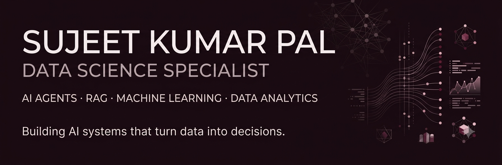

  
  
  
  

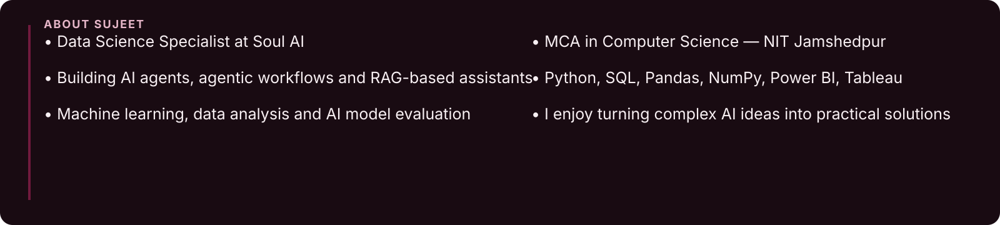

---

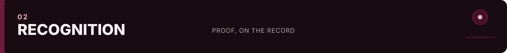

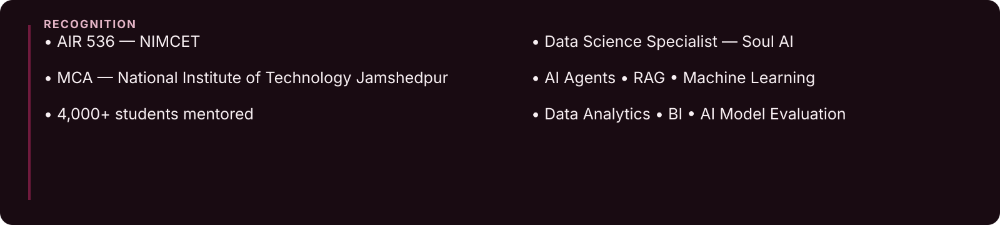

---

<a href="https://github.com/Sujeetpaal21/SDE-Sheet-DSA">
  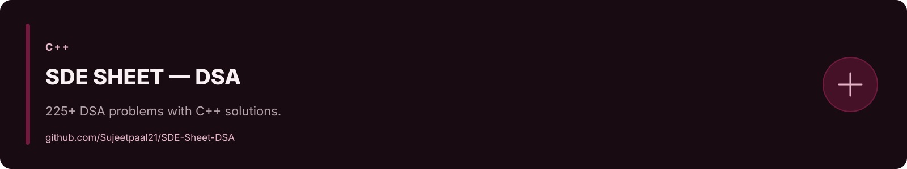
</a>

<a href="https://github.com/Sujeetpaal21/Online-Voting-System">
  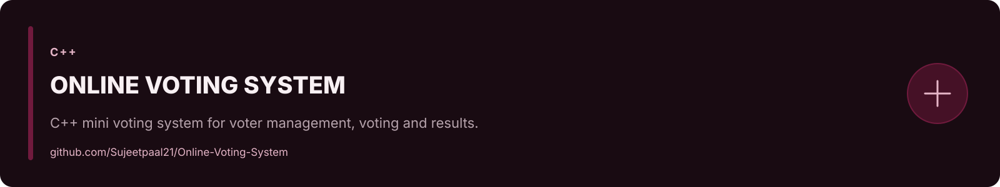
</a>

<a href="https://github.com/Sujeetpaal21/Simple-Chat">
  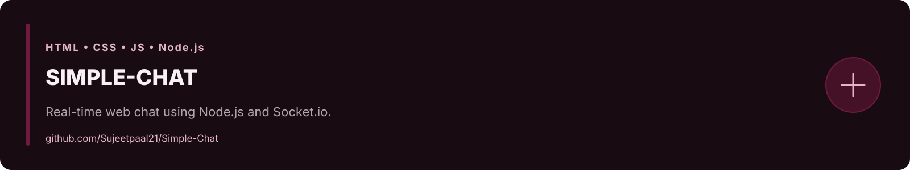
</a>

<a href="https://github.com/Sujeetpaal21/CodeForces">
  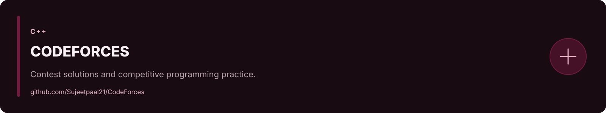
</a>

<a href="https://github.com/Sujeetpaal21/DSA-TOP-50-QUESTIONS">
  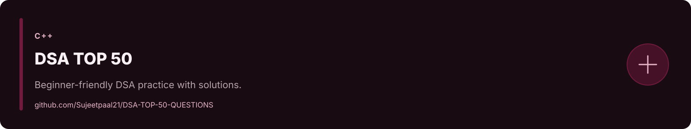
</a>

  

  Private AI-agent, agentic workflow and RAG projects are available on request.

---

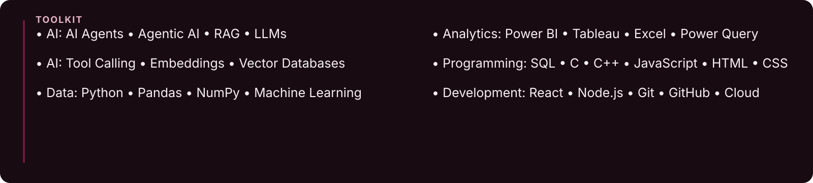

---

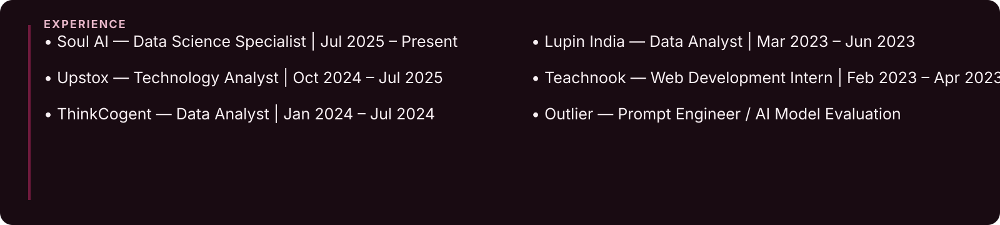

---

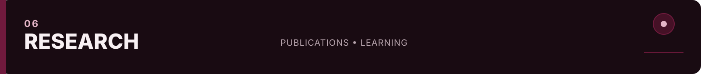

---

---

  
  
  

  

  

  

